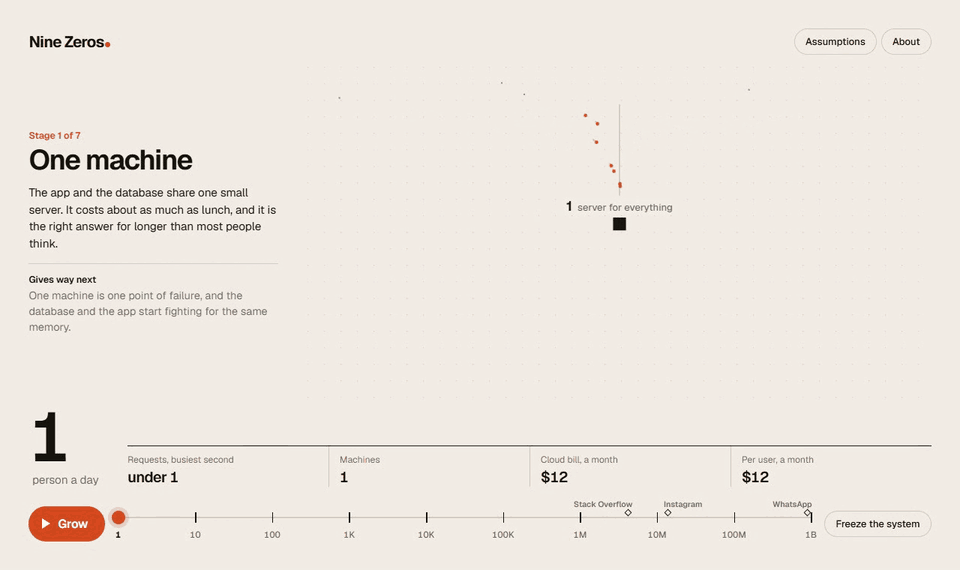
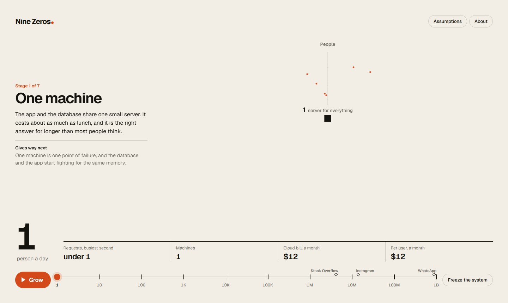
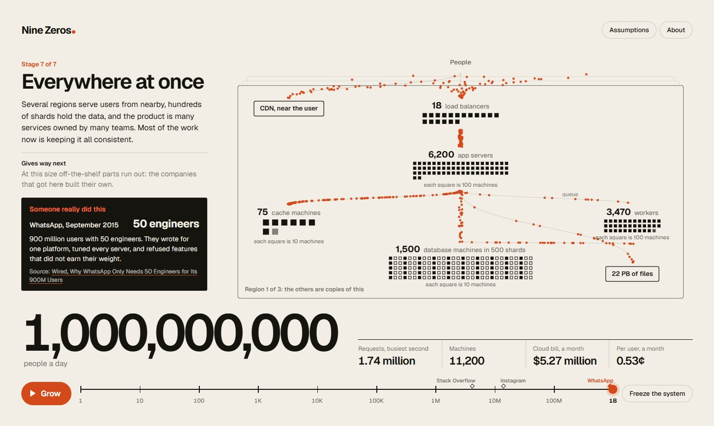
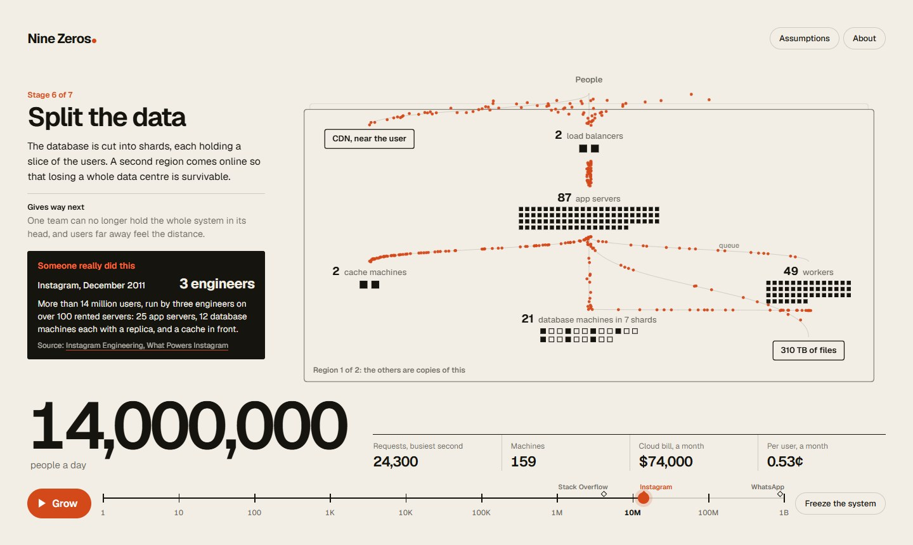
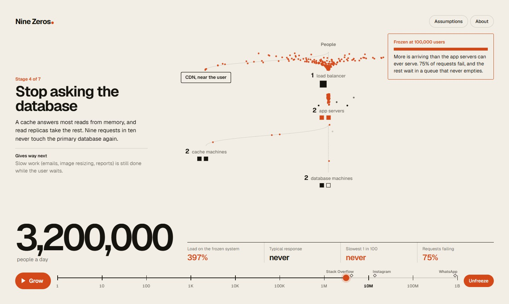
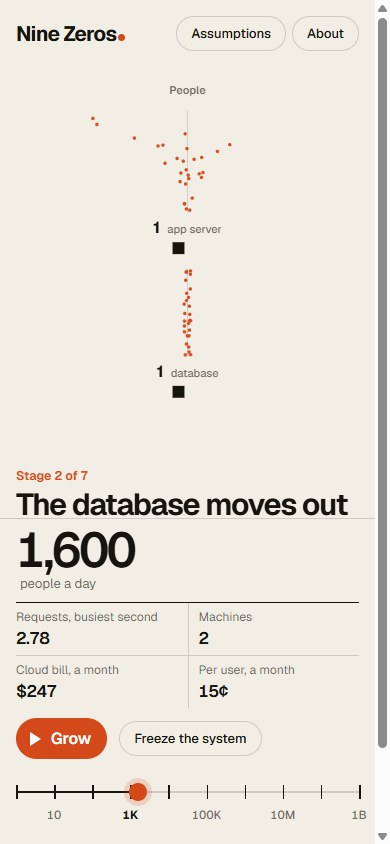
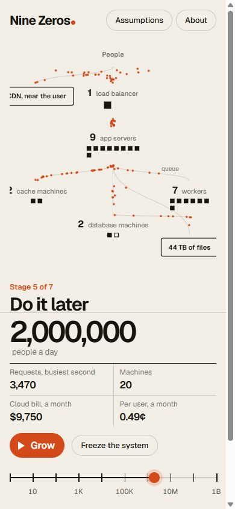
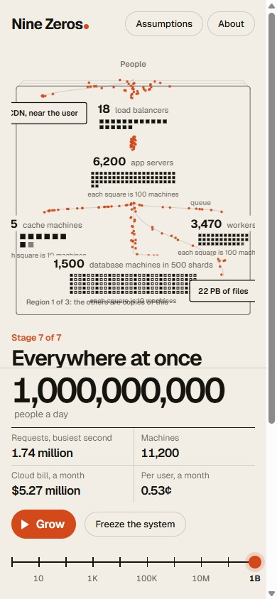

<picture>
  <source media="(prefers-color-scheme: dark)" srcset="assets/hero-dark.svg">
  
</picture>

<p align="center">
  <a href="https://pratyushshivam.github.io/nine-zeros/"><b>Open it</b></a> ·
  <a href="#the-seven-stages">The seven stages</a> ·
  <a href="#freeze-it">Freeze it</a> ·
  <a href="#the-model">The model</a> ·
  <a href="#run-it">Run it</a> ·
  <a href="https://www.pratyushshivam.com/">pratyushshivam.com</a>
</p>

# Nine Zeros

**Will it scale, and what will it cost?** One slider, from 1 user to 1,000,000,000. As you drag, the system redraws itself in front of you: one small server becomes a load balancer and a row of app servers, then a cache, a queue, shards, regions. Orange dots are requests moving through it. A readout keeps the score a founder cares about: requests in the busiest second, machines, the monthly cloud bill, and the cost per user.

Real companies are pinned along the way, each from what its own engineers published. They often did it with far fewer machines than the rules of thumb suggest, and that is the point.

**Open:** [pratyushshivam.github.io/nine-zeros](https://pratyushshivam.github.io/nine-zeros/)

<a href="https://pratyushshivam.github.io/nine-zeros/"></a>

<p align="center"><sub>Pressing <b>Grow</b>, four and a half times faster than it plays. <a href="assets/grow.mp4">Full-quality video</a>.</sub></p>

<table>
<tr>
<td width="50%" valign="top"><br><sub><b>One user.</b> One small server, $12 a month. The right answer for longer than most people think.</sub></td>
<td width="50%" valign="top"><br><sub><b>A billion.</b> Three regions, 11,200 machines, $5.27 million a month: half a cent per user.</sub></td>
</tr>
<tr>
<td width="50%" valign="top"><br><sub><b>Someone really did this.</b> Instagram at 14 million users: three engineers.</sub></td>
<td width="50%" valign="top"><br><sub><b>Frozen.</b> Stop adding machines and keep growing: 397% load, three requests in four fail.</sub></td>
</tr>
</table>

<table>
<tr>
<td width="33%" valign="top"></td>
<td width="33%" valign="top"></td>
<td width="33%" valign="top"></td>
</tr>
</table>

<p align="center"><sub>The same on a phone: drag the rail.</sub></p>

| | |
| :-- | :-- |
| **The slider** | 1 to 1,000,000,000 daily users, on a log scale: each tick is ten times the last |
| **The readout** | Requests in the busiest second, machines, monthly cloud bill, cost per user |
| **Freeze** | Stop the system growing and keep adding users, to watch it slow down and fail |
| **Assumptions** | All sixteen are listed in the app and editable. Change one and everything redraws |
| **Stack** | TypeScript and a 2D canvas. No framework, no backend, static files only |

## The seven stages

| Users | What changes | Why |
| :-- | :-- | :-- |
| **1** | One machine | The app and the database share a small server |
| **1,000** | The database moves out | Losing the app server must not mean losing the data |
| **10,000** | Two of everything in front | A load balancer and several app servers, so one can die or be updated unnoticed. A CDN for static files |
| **100,000** | Stop asking the database | A cache and read replicas: nine requests in ten never touch the primary |
| **1,000,000** | Do it later | A queue and workers for slow jobs, object storage for files, automatic scaling |
| **10,000,000** | Split the data | Shards, because one primary can only write so fast. A second region |
| **100,000,000** | Everywhere at once | Several regions, hundreds of shards, many services and many teams |

## Freeze it

Press **Freeze the system** at any size and keep dragging. The diagram stops growing and the readout switches to what users would feel: load, typical response time, the slowest one in a hundred, and the share of requests failing.

This is the part worth showing a non-engineer. Response time does not rise in step with load. In the M/M/1 queue, the mean response is the service time divided by one minus the load, so a server at 50% takes twice as long as an idle one, at 90% ten times, at 98% fifty times, and past 100% the queue never empties. A system at 95% is not "nearly fine". It is one busy afternoon from down.

## The model

Everything is in one file, [`src/model.ts`](src/model.ts): pure functions with tests, no DOM.

| Part | What it does |
| :-- | :-- |
| **Traffic** | Daily users × requests per user, spread over a day, times a peak factor |
| **App servers** | Peak requests ÷ (what one server can serve × how full it may run), with spare capacity once there is more than one region |
| **Database** | Reads the cache cannot answer go to replicas. Writes and data size decide the number of shards |
| **Cost** | Machines × AWS on-demand list price, plus storage and data transfer |
| **Strain** | The M/M/1 queue: mean = service time ÷ (1 − load), 99th percentile = mean × ln 100 |

**What is real and what is a model.** The prices are AWS public list prices for US East, checked on 11 November 2026. The queueing formula is exact for the queue it describes. The companies are real and sourced. The capacities (700 requests a second per app server, 4,000 reads per database machine, and so on) are rules of thumb: reasonable defaults, not measurements of your system, which is why every one of them is editable in the app.

**What it leaves out.** Salaries, which the model does not count at all. Discounts, which large customers negotiate. And taste: the model adds machines where a good team would first remove work.

### Sources

- Stack Overflow, 2016: [Nick Craver, Stack Overflow: The Architecture, 2016 Edition](https://nickcraver.com/blog/2016/02/17/stack-overflow-the-architecture-2016-edition/)
- Instagram, December 2011: [Instagram Engineering, What Powers Instagram](https://medium.com/instagram-engineering/what-powers-instagram-hundreds-of-instances-dozens-of-technologies-adf2e22da2ad)
- WhatsApp, September 2015: [Wired, Why WhatsApp Only Needs 50 Engineers for Its 900M Users](https://www.wired.com/2015/09/whatsapp-serves-900-million-users-50-engineers/)
- Prices: AWS pricing pages for [EC2](https://aws.amazon.com/ec2/pricing/on-demand/), [RDS](https://aws.amazon.com/rds/postgresql/pricing/), [ElastiCache](https://aws.amazon.com/elasticache/pricing/), [S3](https://aws.amazon.com/s3/pricing/) and [CloudFront](https://aws.amazon.com/cloudfront/pricing/)
- Queueing: L. Kleinrock, *Queueing Systems, Volume 1: Theory* (1975)

## Run it

Needs Node.js 20 or newer.

```bash
npm install
```

```bash
npm run dev
```

| Command | What it does |
| :-- | :-- |
| `npm run dev` | Development server |
| `npm run build` | Static site in `dist/`, ready for any static host |
| `npm test` | Unit tests for the model |
| `npm run typecheck` | TypeScript, no emit |
| `npm run readme` | Rebuilds the title graphic from the model |

Keyboard: `←` `→` fewer and more users, `Shift` with an arrow jumps a whole zero, `Space` grows or pauses, `F` freezes. Add `?at=6` to the address to open at a million.

## Licence

[MIT](LICENSE). The Geist typeface is used under the SIL Open Font License.

<p align="center"><sub>Built by <a href="https://www.pratyushshivam.com/">Pratyush Shivam</a>. The bars in the title graphic are computed from the same model the app runs on, and follow your light or dark theme.</sub></p>
